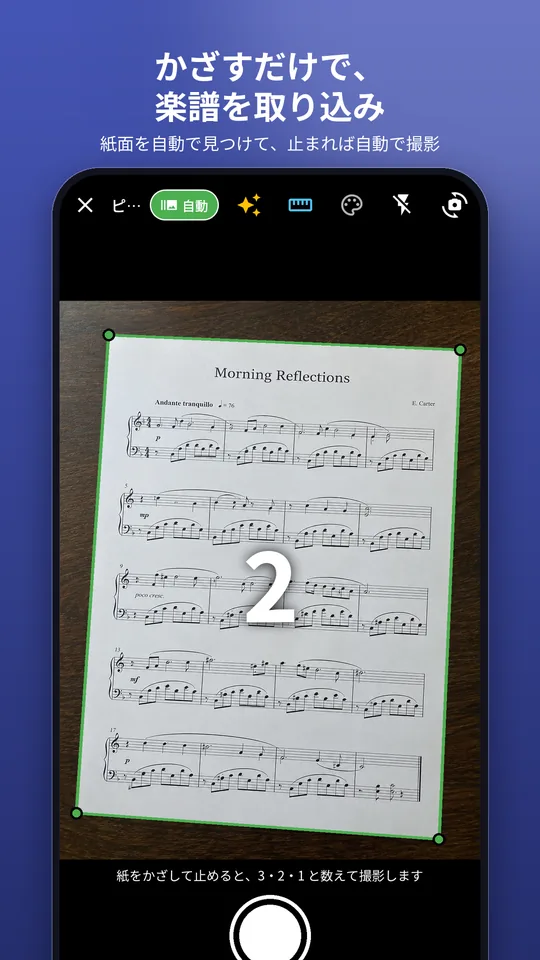
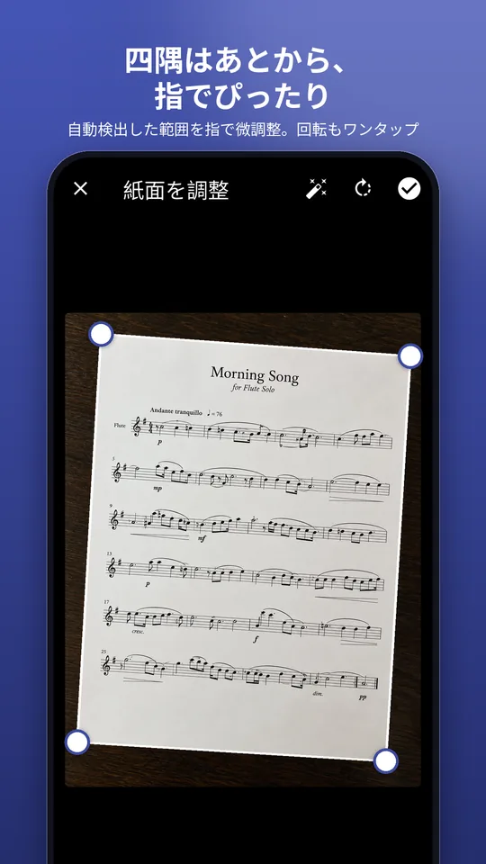
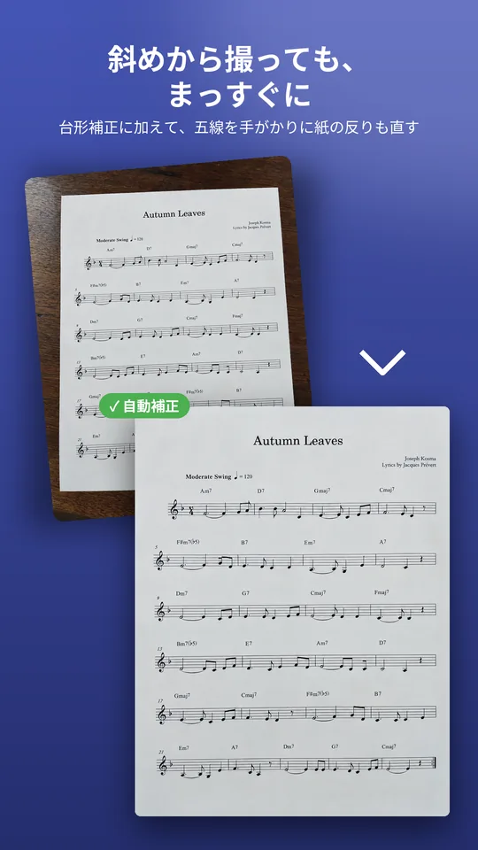
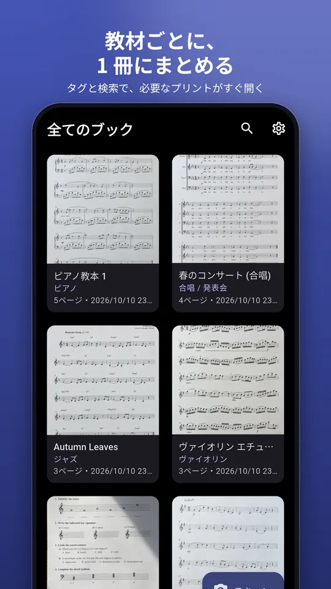
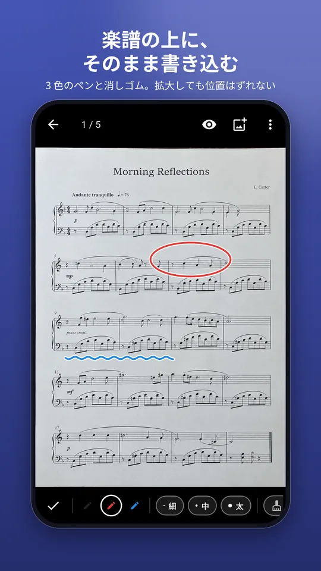
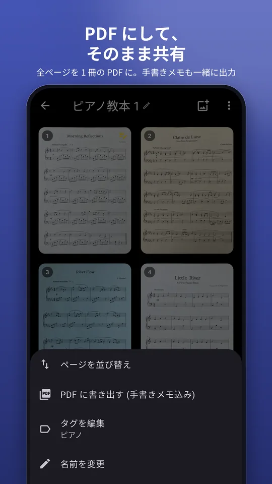
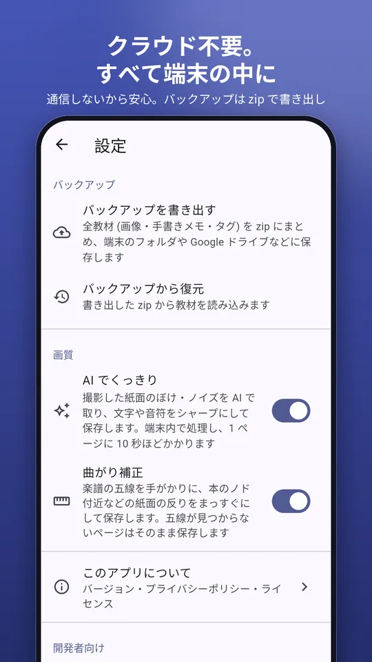

# Futoji

音楽教室の紙資料 (楽譜・プリント・レッスンノートなど) をスマホでスキャンして、
1冊の「デジタル教材」として管理する Flutter アプリです。
名前は「譜 (楽譜) を綴じる」から。2026-10 に MusicBook (mymusicbook) から改名した
(旧名のアプリが書き出したバックアップ zip も復元できる)。

<p align="center"></p>

## スクリーンショット

<p align="center">
  
  
  
  
</p>
<p align="center">
  
  
  
</p>

ストア提出用の元画像 (Google Play スマホ / タブレット、App Store iPhone / iPad、宣伝用画像) は
[docs/store/](docs/store/) にある。楽譜は `training_data/paper_photos/` の生成写真で、
作り方は [docs/RELEASE.md](docs/RELEASE.md) の「ストア掲載画像」。

## 機能

| 機能 | 内容 |
|---|---|
| 📷 カメラ読み取り | 連続撮影対応。1 教材にページをどんどん追加できる |
| 🟢 リアルタイム紙面検出 | プレビュー中も常駐 isolate が約150ms間隔で四隅を検出し、枠をライブ表示 |
| 🤖 自動撮影モード | 紙面が約0.5秒安定したら自動シャッター。切り抜きをスキップして直接保存。紙を入れ替えると次々撮影できる |
| 🔍 紙面検出 | **学習済み超軽量ネット (TinyUNet, ONNX 1.5MB)** で紙マスクを推論 → 純 Dart 後処理 (連結成分 → 凸包 → 最大面積四角形)。モデル不在時はヒューリスティック (大津の二値化ベース) へ自動フォールバック。四隅はドラッグで手動調整・再検出・回転も可能 |
| 📐 台形補正 | 4 点対応からホモグラフィを解き、逆射影 + バイリニア補間で正面から撮ったように補正 |
| 〰️ 曲がり補正 | 楽譜の五線を手がかりに、本のノド付近などの紙面の反りをまっすぐにする (既定 ON、カメラ右上と設定 → 画質で切り替え)。五線が見つからないページは台形補正だけで保存 |
| 💾 WebP ローカル保存 | 本文 (品質84・長辺 2400px) とサムネイル (長辺 420px) を WebP で端末内保存。クラウド不要 |
| 🎨 自動減色オプション | カメラ画面のパレットアイコンで ON。色域を分析し (無彩色寄り→8色 / カラフル→32色)、メディアンカットで色数を絞って軽量保存。平坦な色は完全保持 |
| ⚡ 高速ブラウズ | サムネイルグリッド + 全画面 PageView。隣ページを先読み、ズームしていない時はスワイプでページ送り |
| ✍️ 手書きメモ | ページの上に自由記述。座標は正規化保存なのでどのズームでも同じ位置に表示。ペン色 3 色 × 3 種の太さ・消しゴム・元に戻す・表示/非表示切り替え対応 |
| 📄 PDF 書き出し | 全ページを 1 冊の PDF に。手書きメモもベクトル合成。OS 共有シートで送れる |
| 🔎 タイトル検索 | ホーム画面の虫メガネから教材名で絞り込み |
| ↕️ ページ並べ替え | ページタイル長押しから前後へ移動 |

## 技術構成

- **Flutter 3.47 (Dart 3.13)** / Material 3
- 状態管理: `provider` (シンプルな ChangeNotifier)
- 保存: 画像ファイル (WebP) + メタデータは `hive_ce` (コミュニティ版 Hive、コード生成不要)
- カメラ: `camera` + `permission_handler`
- 画像処理: `image` (デコード/リサイズ) + 自前実装 (検出・ホモグラフィ・台形補正) + `flutter_image_compress` (WebP エンコード)
- 重い処理 (デコード〜補正〜JPEGエンコード) は `Isolate.run` で UI をブロックしない
- PDF 生成: `pdf` (Apache-2.0, 純 Dart) / 共有: `share_plus` (BSD-3)
- 減色: 純 Dart のメディアンカット (`lib/services/color_quantizer.dart`、isolate 内で処理)
- 紙面検出ネット: 自前学習の TinyUNet (~386k パラメータ)。合成データ (ホモグラフィ+照明ムラ+白背景+影+擬似文字) +
  `training_data/paper_photos/` の生成写真200枚 (BiRefNet (MIT) が生成した擬似マスク) で学習。
  ```bash
  python tools/gen_teacher_masks.py --all            # BiRefNet で 200 枚の擬似マスク生成
  python tools/train_paper_net.py --steps 2500 --batch 12 --save-pth
  ```
  実データ 180 枚 / 検証 20 枚に分割し、合成データと 50:50 で混合学習する。
  推論は **dart:ffi で ONNX Runtime C API を直接呼び出し** (`lib/services/ort_ffi.dart`、ネイティブ .so は
  onnxruntime-android を gradle 依存で同梱)。flutter_onnxruntime の Java/JNI 層はリリースビルドで
  クラッシュするため不使用。マスク→四角形の後処理はヒューリスティック検出器と共通 (穴埋め fillHoles 追加)。
  **精度実績**: 合成検証 IoU 0.926 / 実200枚 (対教師) 中央値 0.906。重なり・強い折れ曲がりの
  チャレンジ画像は苦手 (改善は実写ファインチューニングで継続)
- データセットと改善サイクル (収集 → 昇格 → 学習 → 評価) の運用は
  [docs/DATASET.md](docs/DATASET.md) にまとめている。
  `eval_web` (Web 収集の OOD キャナリー) では現行モデルは紙あり 5 枚中クリーン成功 0 —
  アプリの撮り方以外の画像には汎化していない既知の限界
- リリース手順 (署名・ビルド・ストア申告) は [docs/RELEASE.md](docs/RELEASE.md)、
  プライバシーポリシーは [docs/PRIVACY_POLICY.md](docs/PRIVACY_POLICY.md)
- 開発者向け機能 (検出改善用の切り抜き保存・自己診断) は アプリの 設定 → 開発者向け で ON にする (既定 OFF)
- 設定 → 画質 →「AI でくっきり」(既定 OFF) で、保存時に紙面を端末内の AI (Real-ESRGAN 軽量版を int8 化)
  でシャープ化する (実機 1 ページ約 9 秒)。選定と実測は [docs/IMAGE_RECOGNITION_RESEARCH.md](docs/IMAGE_RECOGNITION_RESEARCH.md) の 6c
- 設定 → 画質 →「曲がり補正」(既定 ON) の方式と評価は同文書の 6d。評価ハーネスは
  `flutter test test/staff_dewarp_eval_test.dart` (training_data/eval_hard が無ければスキップ)
- 画像認識モデルの選定記録は [docs/IMAGE_RECOGNITION_RESEARCH.md](docs/IMAGE_RECOGNITION_RESEARCH.md) (MIT/Apache 系の軽量モデル比較)

## ディレクトリ構成

```
lib/
├── main.dart                  # エントリポイント
├── models/                    # データモデル + Hive アダプタ (手書き)
├── services/
│   ├── detector.dart          # 紙面の四隅検出 (純 Dart)
│   ├── warper.dart            # ホモグラフィ + 台形補正 (純 Dart)
│   ├── staff_dewarp.dart      # 五線ベースの曲がり補正 (純 Dart)
│   ├── image_pipeline.dart    # デコード→回転→補正→WebP保存の一連処理
│   ├── db_service.dart        # Hive の初期化
│   ├── storage.dart           # 画像ファイルの保存先管理
│   └── ids.dart               # ID 生成
├── state/app_state.dart       # 教材・ページの CRUD
├── screens/
│   ├── home_screen.dart       # 教材グリッド
│   ├── camera_screen.dart     # 撮影 (連続スキャン)
│   ├── crop_screen.dart       # 四隅調整 / 回転 / 自動検出
│   ├── document_screen.dart   # ページ一覧
│   └── viewer_screen.dart     # 全画面ブラウズ + 手書き
└── widgets/                   # 手書きレイヤー / コーナー枠 / 共通ダイアログ
```

## セットアップ

Flutter SDK は `C:\lib\flutter` にインストール済み (PATH 未登録の場合は以下のように指定)。

```bash
export PATH="/c/lib/flutter/bin:$PATH"   # Git Bash の例

flutter pub get
flutter analyze    # 静的検証
flutter test       # 検出器・台形補正の単体テスト
```

### Android ビルド (実績あり)

```bash
flutter build apk --release
# => build/app/outputs/flutter-apk/app-release.apk (全ABI統合, ~55MB)
flutter build apk --release --split-per-abi
# => app-arm64-v8a-release.apk など (~20MB/ABI)
```

GitHub Actions (`.github/workflows/android.yml`) でも同じ APK を作れる。main への push で Artifacts に、
`v*` タグの push で GitHub Release に添付される (署名の Secrets など詳細は [docs/RELEASE.md](docs/RELEASE.md))。

- 必要環境: Android SDK (cmdline-tools 含む) + `flutter doctor --android-licenses` の承認
- リリース APK は既定でデバッグ鍵で署名される (配布用に署名設定を作る場合は `android/app/build.gradle.kts` を編集)
- ツールチェーン構成 (2026-09 実績): **AGP 9.3.3 / Gradle 9.5.0 / compileSdk 37**
  - `permission_handler_android` 14.x が `compileSdk = 37` を要求するため
    `android/app/build.gradle.kts` で 36 → 37 に上書き、
    `android/settings.gradle.kts` の AGP を 9.1.0 → 9.3.3、
    `android/gradle/wrapper/gradle-wrapper.properties` の Gradle を 9.3.1 → 9.5.0 に更新済み
  - SDK 側は旧来の `platforms;android-37` が新命名 `android-37.0` になった影響で
    `platforms/android-37` (コピー) も用意してある
- `flutter_image_compress_common` が Kotlin Gradle Plugin を適用しているという警告が出るが、
  プラグイン側の将来対応待ちでビルドには影響しない

### 実機で実行 (カメラは実機が必要)

```bash
flutter devices          # 端末を確認
flutter run              # デバッグ実行
flutter install          # ビルド済み APK を実機へインストール
```

iOS (macOS + Xcode が必要。紙面検出の ORT は `ios/Podfile` の `onnxruntime-c`。
iOS は未検証で、確認項目は [docs/RELEASE.md](docs/RELEASE.md)):

```bash
cd ios && pod install && cd ..
flutter run
```

必要な権限は設定済み:
- Android: `AndroidManifest.xml` に `CAMERA` パーミッション
- iOS: `Info.plist` に `NSCameraUsageDescription`

## データの保存場所

- 画像: `<アプリ領域>/futoji/images/<pageId>.webp`, `thumbs/<pageId>.webp`
- メタデータ: Hive box `documents` / `pages` (手書きストロークはページレコード内にベクトル保存)

アンインストールすれば全データ消える。設定 → バックアップ で全教材を zip に書き出し (Android は
保存先を選んで端末フォルダや Google ドライブに保存するか共有シート、iOS は共有シート)、別の端末や再インストール後に復元できる。同じ教材は zip の内容で置き換え、
手元にしかない教材は残す。zip の形式は `lib/services/backup_service.dart` の冒頭に記載。

## ライセンス

本プロジェクトは [MIT License](LICENSE)。
依存パッケージのライセンス (pdf: Apache-2.0, share_plus: BSD-3, その他 Flutter エコシステム標準の寛容ライセンス) は
`flutter pub deps` と各パッケージの LICENSE で確認できる。

## 実装メモ / 既知の制限

- **実機検証済み** (2026-09-24, Lenovo TB-J716F / Android 13 / arm64):
  起動 → カメラ撮影 → 紙面自動検出 (実写の四隅を正しく検出) → 台形補正 → WebP保存 →
  教材グリッド表示 → ビューア表示 → 手書きメモ (赤ペン描画) → 消しゴム部分消去 →
  ライブ検出ストリーム (1600×1200フレームを約150ms間隔で処理) まで確認。
- 自動撮影モードは「紙がフレームに十分入り・約0.5秒静止」が発火条件
  (面積≥18%、移動≤1.2%×3回連続、撮影後3秒クールダウン、8%以上動くと再武装)。
  手動シャッターは従来どおり切り抜き画面で調整できる。
- 横持ち撮影ではセンサー向きの影響で保存結果が 90° 回転することがある。
  切り抜き画面の「回転」ボタンで補正できる (縦持ちでは通常発生しない)。
- 紙面検出は「明るい用紙 × それより暗い背景」を前提とする。白い机の上の白い紙などは自動検出が失敗するが、その場合は全面が初期選択になるので四隅を手動調整する。
- 1 ページあたり長辺 2600px にリサイズしてから補正する (処理時間と画質のバランス)。
- 手書きはストロークベクトルのため、画像を再圧縮しても崩れない。PDF 出力時はレイヤー合成済み。
- Flutter の落とし穴メモ: 非同期インスタンスメソッド内のクロージャを `Isolate.run` に渡すと
  VM のコンテキスト共有で `this` (State) を暗黙キャプチャし「object is unsendable」で落ちる。
  isolate 処理は必ず static メソッド / top-level 関数経由にする (実機で発見・修正済み)。
  また `VerticalDivider` は高さ制約を無限に膨らませるため、固定高の Container で代替。

## 今後の拡張アイデア

- ギャラリーからの取り込み
- ページ並べ替え (ドラッグ&ドロップ)
- 自動連写 (ページめくり検出)
